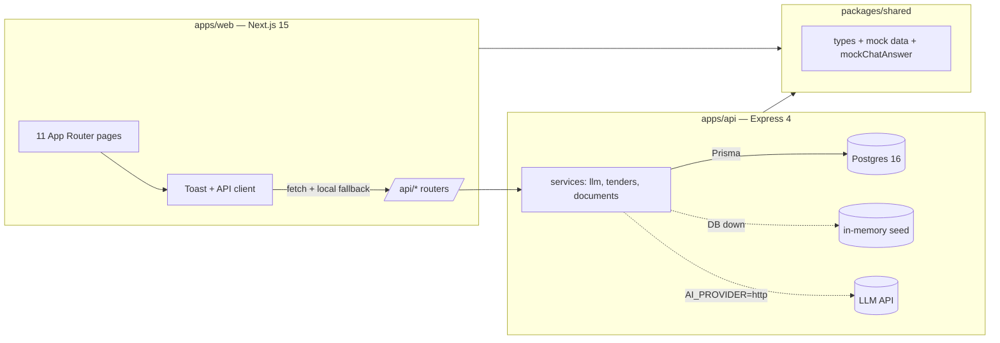

# System Design — Street Smart Cockpit

**Companion to:** `01-requirements-brief.md`
**Status:** Living document — v1.0 (reflects implementation as built)

---

## 1. Architecture Overview

Monorepo (npm workspaces), TypeScript throughout, **mock-first with graceful
fallback at every layer**: UI → API → DB each degrades instead of failing.



### 1.1 Repository layout

```
apps/web        Next.js 15 (App Router, TS, Tailwind v4) — Cockpit UI
apps/api        Express TS — REST API (tsx watch / tsc build)
apps/api/prisma schema.prisma + seed.ts
apps/api/uploads stored user files (gitignored)
packages/shared types + mock data + mock answer branches
docs/           this folder (deliverables)
docker-compose.yml Postgres 16 on host port 5433
figma-make/     original Figma Make reference (do not edit)
```

### 1.2 Design decisions (ADRs, condensed)

| # | Decision | Rationale |
|---|---|---|
| D1 | Mock-first, fall back — never hard-require DB/LLM | Demo/evaluation must run on any laptop with zero keys |
| D2 | Single shared mock dataset (`packages/shared`) | Web + API stay consistent; doubles as evaluation ground truth |
| D3 | Provider abstraction for AI (`AI_PROVIDER=mock\|http`) | Swap to real key (e.g. muse-spark) via env only, no code change |
| D4 | Grounding by construction, not by prompt alone | Tender cards/IDs resolved + validated against live DB rows |
| D5 | Provenance headers (`X-AI-Via`, `X-Data-Via`) | Makes accuracy/time-saved evaluation measurable |
| D6 | Postgres on 5433 | Host port 5432 already occupied; avoids conflicts |
| D7 | Design system referencing style.ai.id | Dark-first tokens, Plus Jakarta Sans / Nunito / JetBrains Mono, glassy cards |

## 2. Frontend (`apps/web`)

- **Framework:** Next.js 15 App Router, React 19, Tailwind v4 (`@tailwindcss/postcss`).
- **Routing:** 11 routes — `/` Discover, `/conversation` (detail; `?q=` prefill, `?new=1` blank),
  `/conversations`, `/spaces`, `/jobs`, `/documents`, `/data`, `/connections`,
  `/reports`, `/status`, `/alerts`. Sidebar has no separate "New conversation" entry;
  `/conversation` highlights **Conversations** (it is a detail view).
- **State:** `lib/store.tsx` (toast), `lib/api.ts` (`get`/`post` with fallback values).
- **Styling:** single `globals.css` design system — CSS variables, `[data-theme]` dark/light,
  theme toggle persisted in `localStorage`, no-JS theme init in `layout.tsx`.
- **Build:** all pages prerendered static; `transpilePackages: ['@street-smart/shared']`.

## 3. Backend (`apps/api`)

| Endpoint | Behaviour |
|---|---|
| `GET /health` | liveness (`mode: mock`) |
| `POST /api/chat` | `chatWithAI()` → routing assistant per-role (`assistantId`/`role`, auto-infer bila absen) → headers `X-AI-Via`, `X-Data-Via`, `X-Assistant` |
| `GET /api/chat/assistants[?role=]` | daftar assistant + skills (registry ala Joule Studio) |
| `GET /api/tenders[?q=]` / `GET /api/tenders/:id` | DB-first + keyword filter, header `X-Data-Via` |
| `GET /api/documents` | list (DB or memory) |
| `POST /api/documents/upload` | multer, 50 MB, allowlist `.pdf .xlsx .xls .csv .docx`; status `Processing` → `Processed` after ~8 s |
| `GET /api/documents/:id/extract` | deterministic structured extraction (tender / sales / quotation / general) |
| `DELETE /api/documents/:id` | metadata + file removal |
| `GET /api/conversations|jobs|alerts|reports/summary` | mock stubs (Prisma-ready) |

### 3.1 AI service (`services/llm.ts`)

```
message → getTenders(message) [live rows + via]
        → provider==http ? chatWithHttp (system prompt injected with ≤20 live rows,
                           response IDs validated against live set)
                         : chatWithMock (cards = live rows matching mock IDs,
                           else top-3 filtered rows) + 600 ms simulated latency
        → on HTTP failure: warn + mock fallback
```

### 3.2 Document service (`services/documents.ts`)

`DocumentStore`: tries Prisma (`DATABASE_URL`), else in-memory seeded with the same
3 samples. Same interface either way, so routes are storage-agnostic.

### 3.3 RAG pipeline (`services/ingest.ts`, `embeddings.ts`, `retrieval.ts`)

```
upload → parse teks asli (pdf-parse / sheetjs / mammoth, max 200rb char)
→ chunk 1500 char + overlap 200 (max 60) → embedding deterministik 384d
→ pgvector (image pgvector/pgvector:pg16, tabel DocumentChunk)
→ chat: embed pertanyaan → cosine distance top-4 (threshold 0.8)
→ chunk disuntik ke prompt + sitasi per chunk di Sources
```

- Embedding = **signed hashing trick** (deterministik, tanpa download/API key):
  onnxruntime tidak ada build darwin/x64 (mesin Intel) dan gateway Go tidak
  punya endpoint `/embeddings`. Interface 384-float identik dengan model neural,
  jadi ganti model tinggal menukar isi `embed()` — skema pgvector tidak berubah.
- Terbukti e2e: PDF tender Auckland (upload) → pertanyaan "berapa unit & kapan
  briefing" dijawab **dari chunk** (4.800 unit SRS-8, briefing 10 Nov 2026)
  dengan sitasi `Auckland_Smart_Road_Tender.pdf bagian #1`.

## 4. Data Model (Prisma / Postgres)

```mermaid
erDiagram
    TENDER ||--o{ CONVERSATION : cited-by
    TENDER {
        string id PK "TND-2026-001"
        string name
        string agency
        string country
        string closeLabel
        string valueDisplay
        string product
        TenderStatus status
        string priority
    }
    CONVERSATION ||--|{ MESSAGE : contains
    CONVERSATION { string id PK, string title, string preview }
    MESSAGE { string id PK, string role, string content }
    DOCUMENT { string id PK, string fileName, string sizeLabel, string status }
    JOB { string id PK, string name, string agent, string state }
```

- `TenderStatus`: `IDENTIFIED | PENDING | SUBMITTED | WON | LOST` → display labels mapped in `services/tenders.ts`.
- Finance: `Invoice` (AR/AP, agregat — tanpa bank detail) + `CloseCheckItem` (per periode, owner = tim).
- HR: `HrPolicy` + `LeaveRow` (agregat tim — tanpa nama/gaji individu, by design).
- Seed: 6 tenders, 5 jobs, 3 documents, 5 invoices, 5 checklist items, 3 policies, 3 roster rows (idempoten via `upsert`/cek `fileName`).
- Assistant registry (`packages/shared`): 5 assistants × 13 skills; `services/finance.ts` + `services/hr.ts` DB-first + mock fallback (pola sama seperti `tenders.ts`).
- Migrations: `prisma migrate dev`; client generated via `prisma:generate`.

## 5. AI Grounding & Anti-Hallucination

1. Chat never invents records: cards are slices of **queried live rows**.
2. HTTP path constrains the model to an injected live list and re-validates returned IDs.
3. Provenance headers + UI disclaimer ("simulated data … verify consequential decisions").

## 6. Security & Operations (prototype scope)

- Secrets only via env (`.env`, gitignored); `.env.example` documents every variable.
- Upload allowlist + size cap; filenames sanitised; uploads dir gitignored.
- No auth (single demo user) — flagged in requirements §7; add before any real deployment.
- Local run: `docker compose up -d db` → migrate → seed → `npm run dev:web`, `npm run dev:api`.

## 7. Known Limitations → Roadmap

1. Extraction = parse teks + chunking (belum OCR/LLM field extraction) → skor terhadap ground-truth set.
2. Embedding = hashing deterministik → ganti model neural saat mesin/kuota memungkinkan; retrieval keyword tender tetap ada, Text-to-SQL menyusul.
3. Add auth, roles, audit log before production.
4. Add `03-test-evaluation-plan.md` with accuracy/usability/time-saved protocol (next deliverable).
